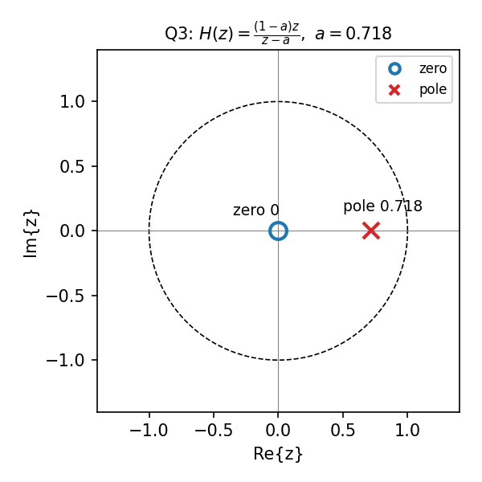
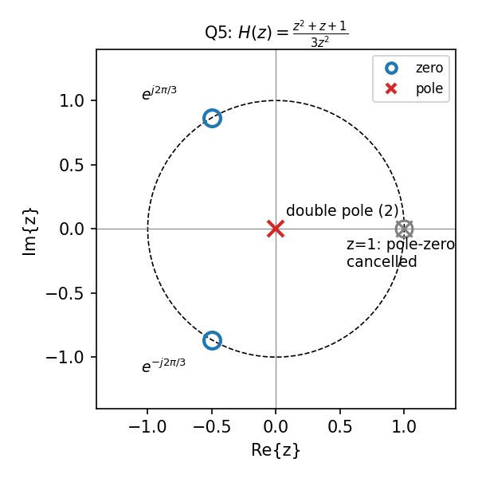
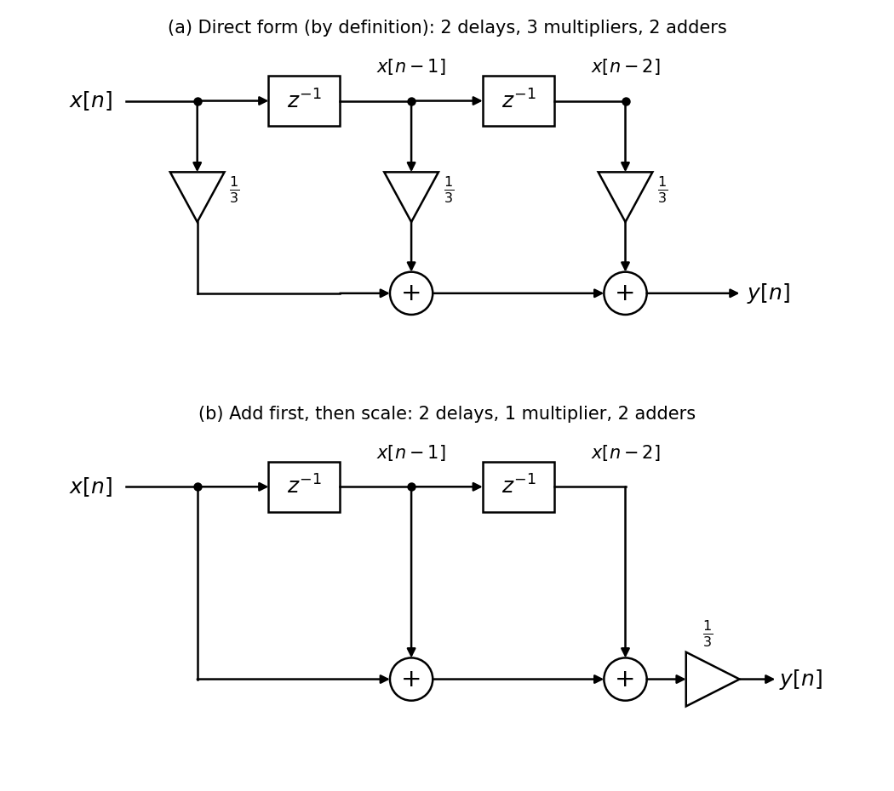
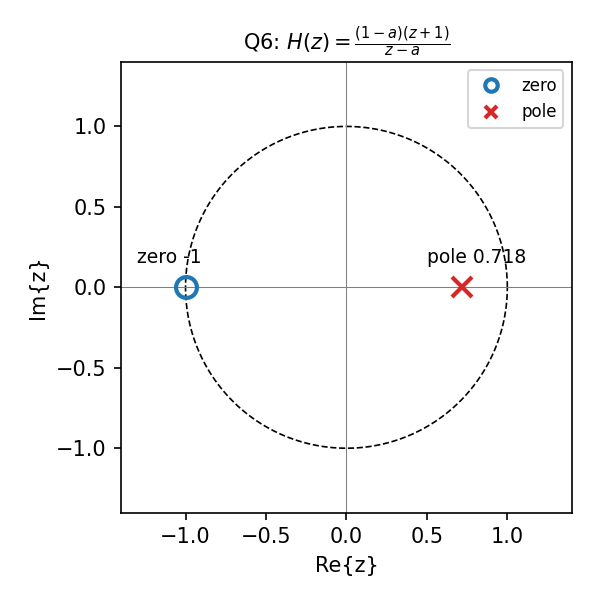
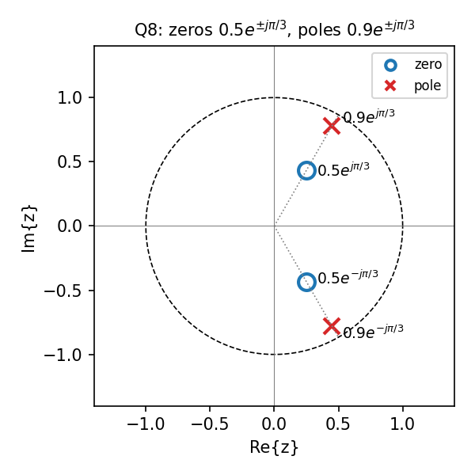
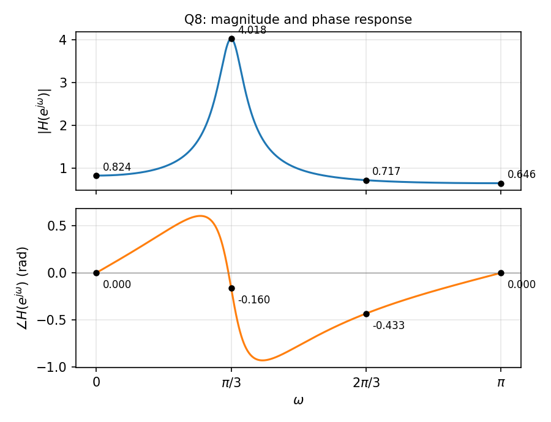

# DSP 2026 紙筆期中考：參考解答（正式考卷）

> 對應 [midterm_final.md](midterm_final.md)。數值除可精確寫出者外，皆四捨五入到小數第 3 位；角度一律為 radian。
>
> 每題先以引用框列出原題，其後為解答。

第 1–7 題共用 HW1 的 RC 低通濾波器差分方程，並假設 **initial rest**（$`y[n]=0,\ n<0`$）：

```math
y[n] = a\,y[n-1] + (1-a)\,x[n], \qquad 0<a<1
```

---

## 第 1 題　脈衝分解與卷積（8 分）

> 設 $`a=0.4`$，輸入 $`x[n]=\delta[n]-\delta[n-1]+2\delta[n-2]`$。
>
> 1. （2 分）直接用差分方程遞迴，計算 $`y[0]`$、$`y[1]`$、$`y[2]`$。
> 2. （3 分）求此系統的脈衝響應 $`h[n]`$，並以卷積和 $`y[n]=\sum_k x[k]\,h[n-k]`$ 重新計算 $`y[0]`$、$`y[1]`$、$`y[2]`$，驗證與第 1 小題相同。
> 3. （3 分）寫出 $`n\ge 2`$ 時 $`y[n]`$ 的一般式。

**解答**

$`a=0.4`$，差分方程為 $`y[n]=0.4\,y[n-1]+0.6\,x[n]`$；輸入 $`x[0]=1,\ x[1]=-1,\ x[2]=2`$，其餘為 0。

**1.** initial rest，$`y[-1]=0`$：

```math
\begin{aligned}
y[0] &= 0.4\cdot 0 + 0.6\cdot 1 = 0.6\\
y[1] &= 0.4\cdot 0.6 + 0.6\cdot(-1) = -0.36\\
y[2] &= 0.4\cdot(-0.36) + 0.6\cdot 2 = 1.056
\end{aligned}
```

**2.** 令 $`x[n]=\delta[n]`$ 遞迴可得

```math
h[n] = (1-a)\,a^n\,u[n] = 0.6\cdot 0.4^{\,n}u[n], \qquad h[0]=0.6,\ h[1]=0.24,\ h[2]=0.096
```

由 LTI 性質 $`y[n]=h[n]-h[n-1]+2h[n-2]`$：

```math
\begin{aligned}
y[0] &= h[0] = 0.6\\
y[1] &= h[1]-h[0] = 0.24-0.6 = -0.36\\
y[2] &= h[2]-h[1]+2h[0] = 0.096-0.24+1.2 = 1.056
\end{aligned}
```

與第 1 小題相同。

**3.** $`n\ge 3`$ 時 $`x[n]=0`$，$`y[n]=0.4\,y[n-1]`$，因此

```math
y[n] = 1.056\cdot 0.4^{\,n-2}, \qquad n\ge 2
```

（也可由 $`h[n]-h[n-1]+2h[n-2]=0.6\cdot0.4^{n-2}(0.16-0.4+2)=1.056\cdot0.4^{n-2}`$ 直接得到。）

## 第 2 題　取樣與離散頻率（8 分）

> 連續時間訊號 $`x(t)=\cos(2\pi\cdot 5000\,t)`$ 以取樣率 $`f_s`$ 取樣，得 $`x[n]=x(n/f_s)`$。
>
> 1. （3 分）$`f_s=12000`$ Hz 時，求數位角頻率 $`\omega`$；$`x[n]`$ 是否為週期序列？若是，求最小週期 $`N`$。
> 2. （3 分）$`f_s=8000`$ Hz 時，回答同樣的問題，並將 $`\omega`$ 化到 $`(-\pi,\pi]`$ 區間內。
> 3. （2 分）第 2 小題的 $`x[n]`$ 與哪一個頻率（Hz）的弦波以 8000 Hz 取樣所得的序列完全相同？若把此 $`x[n]`$ 送進第 3 題的 RC 數位濾波器（$`f_s=8000`$ Hz），其輸出能否代表 5000 Hz 弦波通過連續時間 RC 電路的結果？為什麼？

**解答**

$`\omega=2\pi f_0/f_s`$；$`x[n]=\cos(\omega n)`$ 為週期序列 $`\iff`$ $`\omega/2\pi=k/N`$ 為有理數。

**1.** $`\omega=2\pi\cdot 5000/12000=5\pi/6`$。$`\omega/2\pi=5/12`$（已約分），週期序列，最小週期 $`N=12`$。

**2.** $`\omega=2\pi\cdot 5000/8000=5\pi/4`$。$`\omega/2\pi=5/8`$，週期序列，最小週期 $`N=8`$。化到 $`(-\pi,\pi]`$：$`5\pi/4-2\pi=-3\pi/4`$。

**3.** $`\cos(-3\pi n/4)=\cos(3\pi n/4)`$，與 **3000 Hz** 弦波以 8000 Hz 取樣所得完全相同（$`2\pi\cdot3000/8000=3\pi/4`$）。5000 Hz 超過 Nyquist 頻率 4000 Hz，發生混疊。數位濾波器只看得到 $`x[n]`$，無法分辨它來自 5000 Hz 還是 3000 Hz，因此輸出等同於 3000 Hz 輸入的結果，**不能**代表 5000 Hz 通過連續時間 RC 電路的結果。數值上（不要求作答）：數位濾波器在 $`\omega=3\pi/4`$ 的 $`\lvert H\rvert\approx0.177`$，連續時間 RC 在 5000 Hz 的 $`\lvert H\rvert=1/\sqrt{1+(5000/500)^2}\approx0.100`$。

## 第 3 題　以 z 轉換分析 RC 濾波器（17 分）

> 本題的 RC 電路截止頻率為 500 Hz，取樣率 $`f_s=8000`$ Hz，對應 $`a=0.718`$。
>
> 1. （3 分）對差分方程兩邊取 z 轉換，求系統函數 $`H(z)=Y(z)/X(z)`$。
> 2. （3 分）取 $`a=0.718`$，畫出 pole-zero plot（標出單位圓、極點與零點的位置）。此系統是 FIR 還是 IIR？為什麼？
> 3. （4 分）由 $`H(z)`$ 求脈衝響應 $`h[n]`$（以一般的 $`a`$ 表示），並代入 $`a=0.4`$ 與第 1 題的結果比對。
> 4. （4 分）令 $`z=e^{j\omega}`$，寫出 $`\lvert H(e^{j\omega})\rvert`$ 與 $`\angle H(e^{j\omega})`$。利用 pole-zero plot 上「零點到 $`e^{j\omega}`$」與「極點到 $`e^{j\omega}`$」的向量，說明 $`\omega=0`$ 與 $`\omega=\pi`$ 時的增益各為多少，並說明為何這是低通濾波器。
> 5. （3 分）計算輸入頻率 500 Hz 時的 $`\lvert H\rvert`$ 與 $`\angle H`$，並與連續時間 RC 電路在截止頻率的結果（$`\lvert H\rvert=0.707`$、$`\angle H=-\pi/4`$）比較。

**解答**

**1.**

```math
Y(z)=a z^{-1}Y(z)+(1-a)X(z)\ \Rightarrow\
H(z)=\frac{1-a}{1-a z^{-1}}=\frac{(1-a)\,z}{z-a},\qquad |z|>a
```

**2.** 零點 $`z=0`$，極點 $`z=a=0.718`$（實軸上、單位圓內）。有一個不在原點的極點，$`h[n]`$ 無限長，是 **IIR**。



**3.** 由 $`a^n u[n]\leftrightarrow \dfrac{1}{1-az^{-1}}`$：$`h[n]=(1-a)\,a^n u[n]`$。取 $`a=0.4`$ 即為第 1 題的 $`0.6\cdot0.4^n u[n]`$，一致。

**4.**

```math
\lvert H\rvert=\frac{1-a}{\sqrt{1-2a\cos\omega+a^2}},\qquad
\angle H=-\tan^{-1}\!\frac{a\sin\omega}{1-a\cos\omega}
```

向量觀點：$`H(e^{j\omega})=(1-a)\dfrac{e^{j\omega}-0}{e^{j\omega}-a}`$，零點向量長度恆為 1，$`\lvert H\rvert=\dfrac{1-a}{\lvert e^{j\omega}-a\rvert}`$。

- $`\omega=0`$：與極點距離 $`1-a`$，$`\lvert H\rvert=1`$。
- $`\omega=\pi`$：與極點距離 $`1+a`$，$`\lvert H\rvert=\dfrac{1-a}{1+a}=\dfrac{0.282}{1.718}\approx0.164`$。

$`\omega`$ 從 0 增加到 $`\pi`$，$`e^{j\omega}`$ 離極點越來越遠，增益單調遞減，是低通。

**5.** $`\omega=2\pi\cdot500/8000=\pi/8`$，$`\cos\omega=0.924`$、$`\sin\omega=0.383`$：

```math
\lvert H\rvert=\frac{0.282}{\sqrt{1-2(0.718)(0.924)+0.516}}\approx 0.649,\qquad
\angle H=-\tan^{-1}\frac{0.275}{0.337}\approx-0.685
```

連續時間在截止頻率為 0.707、$`-\pi/4\approx-0.785`$。數位版本增益略小、相位落後較少；後向差分近似使等效 −3 dB 頻率約 426 Hz，低於 500 Hz。

## 第 4 題　弦波輸入的輸出（8 分）

> 沿用第 3 題的濾波器（$`f_s=8000`$ Hz、$`a=0.718`$），輸入對所有 $`n`$（$`-\infty<n<\infty`$）定義為
>
> ```math
> x[n] = 3\cos\!\left(2\pi\frac{200}{8000}n\right) + \cos\!\left(2\pi\frac{2000}{8000}n\right)
> ```
>
> 已知：
>
> | 頻率 | $`\lvert H\rvert`$ | $`\angle H`$（rad） |
> |---|---|---|
> | 200 Hz | 0.904 | $`-0.369`$ |
> | 2000 Hz | 0.229 | $`-0.623`$ |
>
> 1. （5 分）利用 $`e^{j\omega n}`$ 是 LTI 系統的 eigenfunction，求輸出 $`y[n]`$。
> 2. （3 分）以第 3 題第 4 小題的公式，驗算 2000 Hz 的 $`\lvert H\rvert=0.229`$ 與 $`\angle H=-0.623`$（寫出計算過程）。

**解答**

**1.** $`h[n]`$ 為實數，$`\cos(\omega n)\to\lvert H\rvert\cos(\omega n+\angle H)`$。$`\omega_1=2\pi\cdot200/8000=\pi/20`$，$`\omega_2=\pi/2`$：

```math
y[n]=2.712\cos\!\left(\frac{\pi}{20}n-0.369\right)+0.229\cos\!\left(\frac{\pi}{2}n-0.623\right)
```

**2.** $`\omega=\pi/2`$：$`\cos\omega=0`$、$`\sin\omega=1`$。

```math
\lvert H\rvert=\frac{0.282}{\sqrt{1+0.718^2}}=\frac{0.282}{1.231}\approx0.229,\qquad
\angle H=-\tan^{-1}\frac{0.718}{1}\approx-0.623
```

## 第 5 題　moving average FIR 與 RC 低通比較（17 分）

> 把 HW1 `RC_filtering.c` 中的濾波器換成 3 點 moving average：
>
> ```math
> y[n] = \frac{1}{3}\sum_{k=0}^{2} x[n-k]
> ```
>
> 1. （3 分）求 $`h[n]`$，並證明 $`H(z)=\dfrac{1}{3}\cdot\dfrac{1-z^{-3}}{1-z^{-1}}`$。
> 2. （4 分）畫出 pole-zero plot。$`z=1`$ 處發生什麼事？雖然 $`H(z)`$ 寫成分式，為什麼此系統仍是 FIR？
> 3. （5 分）導出 $`H(e^{j\omega})=e^{-j\omega}\,\dfrac{\sin(1.5\omega)}{3\sin(\omega/2)}`$，並計算 $`\omega=0,\ \pi/3,\ 2\pi/3`$ 時的 $`\lvert H\rvert`$；與第 3 題 RC 濾波器（$`a=0.718`$）在相同頻率的 $`\lvert H\rvert`$ 比較。
> 4. （5 分）
>    - 畫出 moving average 濾波器的 block diagram（使用延遲單元 $`z^{-1}`$、加法器、乘法器）。
>    - 依 $`h[n]`$ 是否對稱，判斷 moving average 與 RC 濾波器何者為線性相位。
>    - 比較兩者每個輸出樣本所需的乘法次數。

**解答**

**1.** $`h[n]=\tfrac13(\delta[n]+\delta[n-1]+\delta[n-2])`$。

```math
H(z)=\frac13\sum_{k=0}^{2}z^{-k}=\frac13\cdot\frac{1-z^{-3}}{1-z^{-1}}\quad(\text{等比級數和})
```

**2.** $`1-z^{-3}=0`$ 的根為 $`z=1,\ e^{\pm j2\pi/3}`$；$`z=1`$ 的極點與零點**抵消**：

```math
H(z)=\frac{z^2+z+1}{3z^2}
```

零點在 $`e^{\pm j2\pi/3}`$（單位圓上），兩個極點都在原點，$`h[n]`$ 只有 3 個非零值，仍是 **FIR**。



**3.**

```math
H(e^{j\omega})=\frac13\cdot\frac{e^{-j3\omega/2}(e^{j3\omega/2}-e^{-j3\omega/2})}{e^{-j\omega/2}(e^{j\omega/2}-e^{-j\omega/2})}
=e^{-j\omega}\,\frac{\sin(1.5\omega)}{3\sin(\omega/2)}
```

| $`\omega`$ | moving average $`\lvert H\rvert`$ | RC（$`a=0.718`$）$`\lvert H\rvert`$ |
|---|---|---|
| 0 | 1 | 1 |
| $`\pi/3`$ | $`\dfrac{\sin(\pi/2)}{3\sin(\pi/6)}=\dfrac{2}{3}\approx0.667`$ | 0.316 |
| $`2\pi/3`$ | 0（$`e^{j2\pi/3}`$ 為零點） | 0.189 |

moving average 在 $`2\pi/3`$ 完全歸零，但在 $`\omega=\pi`$ 又回升到 $`1/3`$；RC 單調下降、不歸零。$`\pi/3`$ 處 moving average 衰減得比 RC 少。

**4.**

- Block diagram：$`x[n]`$ 經兩個串接的延遲單元 $`z^{-1}`$ 得 $`x[n-1],x[n-2]`$；(a) 依定義，三路各乘 $`1/3`$ 後用兩個加法器相加（3 個乘法器、2 個加法器）；(b) 也可先相加再乘 $`1/3`$（1 個乘法器、2 個加法器）。兩種皆給分。

  

- 線性相位：$`h[n]`$ 對 $`n=1`$ 對稱，$`\angle H=-\omega`$（$`\sin(1.5\omega)`$ 變號處另有 $`\pi`$ 跳躍），是線性相位；RC 的 $`h[n]`$ 不對稱，不是線性相位。
- 乘法次數：moving average 先加後乘 1 次（各乘 $`1/3`$ 則 3 次）；RC 2 次。

## 第 6 題　RC 低通串接一階 FIR（12 分）

> 將 RC 低通濾波器（$`a=0.718`$）的輸出 $`y[n]`$ 再送進 $`w[n]=y[n]+y[n-1]`$。
>
> 1. （2 分）求整體系統函數 $`H(z)=W(z)/X(z)`$。
> 2. （3 分）畫出 pole-zero plot，判斷整體系統是 FIR 還是 IIR。
> 3. （4 分）由 $`H(z)`$ 求整體脈衝響應 $`h[n]`$，分別寫出 $`h[0]`$ 與 $`n\ge1`$ 時的 $`h[n]`$。
> 4. （3 分）求 $`\omega=0`$ 與 $`\omega=\pi`$ 的增益，並說明這是什麼類型的濾波器。

**解答**

**1.**

```math
H(z)=\frac{(1-a)(1+z^{-1})}{1-a z^{-1}}=\frac{(1-a)(z+1)}{z-a}
```

**2.** 零點 $`z=-1`$，極點 $`z=a=0.718`$，是 **IIR**。



**3.**

```math
h[n]=(1-a)\left[a^n u[n]+a^{n-1}u[n-1]\right]
```

- $`h[0]=1-a=0.282`$
- $`n\ge1`$：$`h[n]=(1-a)(a^n+a^{n-1})=(1-a^2)\,a^{n-1}=0.484\cdot0.718^{\,n-1}`$

（驗證：$`\sum_n h[n]=(1-a)+\dfrac{1-a^2}{1-a}=(1-a)+(1+a)=2=H(1)`$。）

**4.** $`\omega=0`$：$`\dfrac{(1-a)\cdot2}{1-a}=2`$。$`\omega=\pi`$：$`z=-1`$ 是零點，增益 0。低頻通過、高頻被擋，是**低通**濾波器（比單獨 RC 在 $`\omega=\pi`$ 衰減更徹底；DC 增益為 2）。

## 第 7 題　C 程式（12 分）

> 1. （6 分）寫出 C 函式，實作第 6 題的整體系統，必須符合 initial rest，且不得存取 `x[-1]`、`y[-1]` 等陣列範圍外的元素：
>
>    ```c
>    void rc_sum(const double *x, double *w, int N, double a);
>    ```
>
> 2. （4 分）下列程式片段要實作 HW1 式 (8)，其中有兩個錯誤。請指出並改正。
>
>    ```c
>    int fs = 8000;
>    double RC = 1.0 / (2 * M_PI * 500);
>    double tau = 1.0 / fs;
>    double a = RC / RC + tau;
>    double y_prev = 0.0;
>
>    for (int n = 0; n <= N; n++) {
>        y[n] = a * y_prev + (1 - a) * x[n];
>        y_prev = y[n];
>    }
>    ```
>
> 3. （2 分）對長度 $`N`$ 的輸入，第 5 題的 moving average（直接依定義計算）與第 6 題的系統，總共各需要多少次乘法？

**解答**

**1.**

```c
void rc_sum(const double *x, double *w, int N, double a)
{
    double y_prev = 0.0;                 /* initial rest: y[-1] = 0 */
    for (int n = 0; n < N; n++) {
        double y = a * y_prev + (1.0 - a) * x[n];
        w[n] = y + y_prev;               /* w[n] = y[n] + y[n-1] */
        y_prev = y;
    }
}
```

評分重點：用變數保存 $`y[n-1]`$ 並初始化為 0、不存取陣列範圍外的元素、型別為 `double`。

**2.**

- `double a = RC / RC + tau;` 運算子優先順序錯誤，算成 $`(RC/RC)+\tau=1+\tau>1`$，極點跑到單位圓外、系統不穩定。改成 `double a = RC / (RC + tau);`。
- 迴圈條件 `n <= N` 會寫入 `y[N]`、讀取 `x[N]`，超出陣列範圍。改成 `n < N`。
- 註：`M_PI` 不屬於 C 標準，但 gcc／MinGW 的 `math.h` 有提供，本題不算錯誤。

**3.**

- moving average：先加後乘 $`1/3`$ 共 $`N`$ 次；若每項各乘 $`1/3`$ 則 $`3N`$ 次（兩種皆可，需說明算法）。
- 第 6 題：每個輸出 2 次（$`a\cdot y[n-1]`$、$`(1-a)\cdot x[n]`$），相加不需乘法，共 $`2N`$ 次。

## 第 8 題　二階 IIR：複數極點與零點（18 分）

> 響度量測標準（ITU-R BS.1770 的 K-weighting）用二階 IIR 濾波器（biquad）調整各頻帶的權重。下面是一個二階 IIR（biquad）的例子，取樣率 $`f_s=48000`$ Hz，initial rest：
>
> ```math
> y[n] = x[n] - 0.5\,x[n-1] + 0.25\,x[n-2] + 0.9\,y[n-1] - 0.81\,y[n-2]
> ```
>
> 1. （2 分）求系統函數 $`H(z)`$。
> 2. （4 分）求兩個零點與兩個極點，以極座標 $`re^{\pm j\theta}`$ 表示，並畫出 pole-zero plot（標出單位圓）。此系統是否穩定？是 FIR 還是 IIR？
> 3. （2 分）用遞迴計算脈衝響應 $`h[0]`$ 到 $`h[4]`$。
> 4. （5 分）計算 $`\omega=0,\ \pi/3,\ 2\pi/3,\ \pi`$ 時的 $`\lvert H(e^{j\omega})\rvert`$ 與 $`\angle H(e^{j\omega})`$，畫出 $`0\le\omega\le\pi`$ 的振幅響應與相位響應草圖。利用 pole-zero plot 上的向量說明：振幅響應的峰值為何出現在 $`\omega=\pi/3`$ 附近？此濾波器加強了哪一個頻率（Hz）附近的訊號？
> 5. （5 分）下列輸入皆對所有 $`n`$（$`-\infty<n<\infty`$）定義，分別寫出輸出 $`y[n]`$：
>    - $`x_1[n]=1`$
>    - $`x_2[n]=\cos(\pi n/3)`$
>    - $`x_3[n]=\cos(2\pi n/3+\pi/4)`$
>    - $`x_4[n]=(-1)^n`$
>    - $`x_5[n]=x_1[n]+x_3[n]`$
>
>    並說明 $`x_2`$ 與 $`x_3`$ 各對應多少 Hz 的類比訊號。

**解答**

**1.**

```math
H(z)=\frac{1-0.5z^{-1}+0.25z^{-2}}{1-0.9z^{-1}+0.81z^{-2}}=\frac{z^2-0.5z+0.25}{z^2-0.9z+0.81}
```

**2.** 分子 $`z^2-0.5z+0.25=0`$：$`z=0.25\pm j0.433=0.5e^{\pm j\pi/3}`$。分母 $`z^2-0.9z+0.81=0`$：$`z=0.45\pm j0.779=0.9e^{\pm j\pi/3}`$。

（對照 $`(1-re^{j\theta}z^{-1})(1-re^{-j\theta}z^{-1})=1-2r\cos\theta\,z^{-1}+r^2z^{-2}`$：$`2r\cos\theta=0.5,\ r^2=0.25`$ 得 $`r=0.5,\ \theta=\pi/3`$；$`2r\cos\theta=0.9,\ r^2=0.81`$ 得 $`r=0.9,\ \theta=\pi/3`$。）

零點與極點在同一條 $`\pm\pi/3`$ 射線上，極點較靠近單位圓。極點 $`|p|=0.9<1`$，因果系統**穩定**；極點不在原點，是 **IIR**。



**3.** $`h[n]=\delta[n]-0.5\delta[n-1]+0.25\delta[n-2]+0.9h[n-1]-0.81h[n-2]`$：

| $`n`$ | 0 | 1 | 2 | 3 | 4 |
|---|---|---|---|---|---|
| 計算 | 1 | $`-0.5+0.9`$ | $`0.25+0.36-0.81`$ | $`-0.18-0.324`$ | $`-0.4536+0.162`$ |
| $`h[n]`$ | 1 | 0.4 | −0.2 | −0.504 | −0.2916 |

**4.** $`e^{-j\pi/3}=0.5-0.866j`$，$`e^{-j2\pi/3}=-0.5-0.866j`$，$`e^{-j4\pi/3}=-0.5+0.866j`$。

| $`\omega`$ | 分子 $`N`$ | 分母 $`D`$ | $`\lvert H\rvert`$ | $`\angle H`$ |
|---|---|---|---|---|
| 0 | 0.75 | 0.91 | 0.824 | 0 |
| $`\pi/3`$ | $`0.625+0.217j`$ | $`0.145+0.078j`$ | $`\dfrac{0.661}{0.1646}=4.018`$ | $`0.334-0.493=-0.160`$ |
| $`2\pi/3`$ | $`1.125+0.650j`$ | $`1.045+1.481j`$ | $`\dfrac{1.299}{1.812}=0.717`$ | $`0.524-0.956=-0.433`$ |
| $`\pi`$ | 1.75 | 2.71 | 0.646 | 0 |

草圖：

- 振幅：$`\omega=\pi/3`$ 附近有尖峰（約 4.02，約 +12.1 dB），兩側降到 0.6–0.8；最小值約 0.646 在 $`\omega=\pi`$。
- 相位：從 0 開始上升，約 $`0.26\pi`$ 達最大約 0.61；之後快速下降，約在 $`0.33\pi`$（略早於 $`\pi/3`$）穿過 0，約 $`0.41\pi`$ 達最小約 −0.93；再逐漸回升，$`\omega=\pi`$ 回到 0。



向量解釋：$`\omega=\pi/3`$ 時 $`e^{j\pi/3}`$ 與極點 $`0.9e^{j\pi/3}`$ 距離只有 0.1，與零點 $`0.5e^{j\pi/3}`$ 距離 0.5；另一對共軛點的距離為 $`\lvert e^{j\pi/3}-0.5e^{-j\pi/3}\rvert=1.323`$、$`\lvert e^{j\pi/3}-0.9e^{-j\pi/3}\rvert=1.646`$：

```math
\lvert H(e^{j\pi/3})\rvert=\frac{0.5\times1.323}{0.1\times1.646}\approx4.018
```

極點最靠近單位圓的方向就是峰值方向。$`\omega=\pi/3`$ 對應 $`f=f_s/6=8`$ kHz，此濾波器加強 8 kHz 附近的訊號。

**5.**

| 輸入 | $`\omega`$ | 輸出 $`y[n]`$ |
|---|---|---|
| $`x_1=1`$ | 0 | $`0.824`$ |
| $`x_2=\cos(\pi n/3)`$ | $`\pi/3`$ | $`4.018\cos(\pi n/3-0.160)`$ |
| $`x_3=\cos(2\pi n/3+\pi/4)`$ | $`2\pi/3`$ | $`0.717\cos(2\pi n/3+\pi/4-0.433)`$ |
| $`x_4=(-1)^n`$ | $`\pi`$ | $`0.646(-1)^n`$ |
| $`x_5=x_1+x_3`$ | — | $`0.824+0.717\cos(2\pi n/3+\pi/4-0.433)`$（線性疊加） |

類比頻率 $`f=\omega f_s/2\pi`$：$`x_2`$ 為 8 kHz，$`x_3`$ 為 16 kHz（$`x_4`$ 為 24 kHz，即 Nyquist 頻率）。
